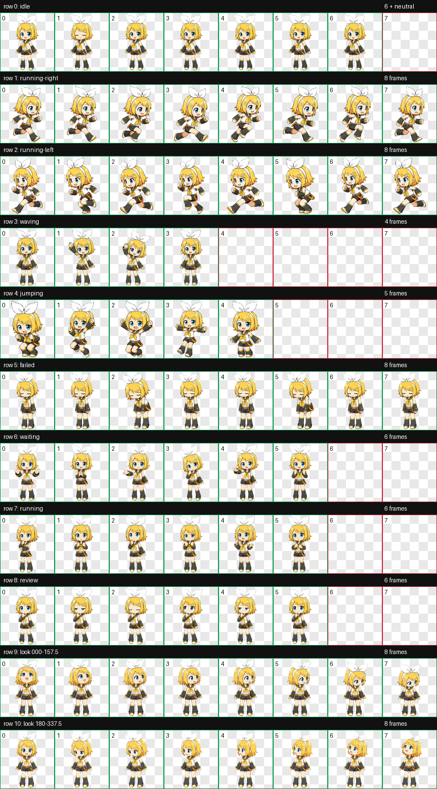

# Kagamine Rin Codex Pet + RinTrace

[](https://github.com/KanadeK/kagamine-rin-codex-pet/actions/workflows/ci.yml)
[](https://kanadek.github.io/kagamine-rin-codex-pet/)
[](https://github.com/KanadeK/kagamine-rin-codex-pet/releases/latest)
[](LICENSE)
[](ASSET_LICENSE.md)

**A complete Kagamine Rin Codex v2 pet—and a privacy-safe way to replay a
coding session without publishing its contents.**



[中文说明](README.zh-CN.md) ·
[Live offline-stage demo](https://kanadek.github.io/kagamine-rin-codex-pet/) ·
[Download the latest `.codex-pet`](https://github.com/KanadeK/kagamine-rin-codex-pet/releases/latest)

## What ships

This is not a theme, a mockup, or a single idle image.

- A real Codex `spriteVersionNumber: 2` pet: 8×11 atlas, 192×208 cells,
  9 standard animation states, and all 16 clockwise look directions.
- **RinTrace**, a local JSONL parser that retains only allow-listed lifecycle
  metadata and discards prompts, messages, tool arguments/results, paths, and
  account values.
- A network-independent HTML/Canvas replay stage that animates the sanitized
  timeline and lets you test every atlas state and look direction.
- Strict atlas/provenance/checksum validation.
- Validate-before-write installation, backup-first repair, diagnosis, and
  recoverable uninstall.
- Deterministic full-project ZIP and standalone `.codex-pet` archives.
- Python and JavaScript tests, secret scan, GitHub Actions, Pages, release
  automation, and a time-separated reproducibility gate.

## Quick start

Requirements: Python 3.11+ and Git. Node.js 20+ is needed only for development
tests.

```bash
git clone https://github.com/KanadeK/kagamine-rin-codex-pet.git
cd kagamine-rin-codex-pet
python -m venv .venv
```

Activate the environment:

```bash
# Windows PowerShell
.\.venv\Scripts\Activate.ps1

# macOS / Linux
source .venv/bin/activate
```

Then validate and install:

```bash
python -m pip install -r requirements.txt
python -m rin_pet validate pet --strict --json
python -m rin_pet install --source pet --dry-run --json
python -m rin_pet install --source pet --json
python -m rin_pet doctor --source pet --json
```

The installer writes only to the selected Codex home (normally
`~/.codex/pets/kagamine-rin`) and never modifies another pet. Existing Rin
files are moved to a timestamped backup before replacement.

In Codex, open **Settings → Appearance → Pets** or use `/pet` to select a
custom pet. The current OpenAI guidance for custom pets is documented in the
[Codex manual](https://developers.openai.com/codex/app/features/#pets).

## Run the real demo

The fixture deliberately contains `PRIVATE_*` message, path, tool, and result
values. RinTrace must remove all of them before the stage is built.

```bash
python -m rin_pet demo --output dist/demo --json
python -m http.server 8000 --directory dist/demo/site
```

Open `http://localhost:8000`. The stage loads only local HTML, CSS, JavaScript,
the pet atlas, and the sanitized timeline. It has no analytics, CDN, font,
framework, or runtime API dependency.

To sanitize your own local JSONL:

```bash
python -m rin_pet trace path/to/session.jsonl \
  --output tmp/session-timeline.json --json
python -m rin_pet stage \
  --timeline tmp/session-timeline.json \
  --output tmp/session-stage --json
```

Do not commit or upload the source session. See the exact
[privacy contract](docs/TRACE_SCHEMA.md).

## Privacy model

| RinTrace keeps | RinTrace discards |
| --- | --- |
| Allow-listed structural event kind | Prompt and message text |
| Animation state | Reasoning summaries |
| Relative offset and bounded duration | Tool names, arguments, and output |
| Source line number | File paths and environment values |
| Input byte count, record count, SHA-256 | Account, email, and error contents |

Unknown `type` values become `activity`; they are never copied into output.
Absolute timestamps are converted to offsets. Input is capped at 50 MiB and
100,000 records. Every output event is schema-validated again in the browser.

## Commands

| Command | Purpose |
| --- | --- |
| `rin-pet validate pet --strict --json` | Check v2 topology, cells, pixels, provenance, and hashes |
| `rin-pet trace input.jsonl --output timeline.json` | Produce a content-free structural timeline |
| `rin-pet stage --timeline timeline.json --output site` | Build the offline replay stage |
| `rin-pet demo --output dist/demo` | Parse the safe fixture and build a complete demo |
| `rin-pet install --source pet --dry-run` | Validate installation without writing |
| `rin-pet doctor --source pet` | Diagnose the installed copy and compare its atlas |
| `rin-pet repair --source pet` | Replace atomically after making a backup |
| `rin-pet uninstall` | Move the installation into the backup store |
| `rin-pet pack` | Build the deterministic full-project ZIP |
| `rin-pet pack-pet` | Build the standalone deterministic `.codex-pet` |
| `rin-pet verify-package FILE --sha256 HASH` | Verify a downloaded artifact |

Every command has `--help`; mutating commands support `--dry-run` where it is
meaningful.

## Acceptance gate

```bash
python -m pip install -r requirements-dev.txt
python -m ruff check .
python -m ruff format --check .
python -m coverage run -m unittest discover -s tests -v
python -m coverage report
node --test tests/js/runtime.test.mjs
python scripts/secret_scan.py --json
python scripts/release_check.py --json
```

The final gate also:

1. strictly validates all 74 used cells, including the neutral look frame,
   and 14 transparent padding cells;
2. regenerates the sanitized golden timeline byte-for-byte;
3. builds the offline site;
4. builds both release archives twice, separated by more than one second;
5. compares the archive bytes, not only file lists;
6. checks internal ZIP timestamps, hashes, sizes, and path safety;
7. rejects `Co-authored-by` trailers and (unless explicitly allowed) a dirty
   worktree.

Build and verify release assets:

```bash
python scripts/build_release.py --version 0.1.0 --output dist --json
python scripts/verify_release.py \
  --artifacts dist \
  --manifest dist/release-manifest.json \
  --checksums dist/SHA256SUMS \
  --json
```

If anything fails, follow the non-destructive
[diagnosis and repair runbook](docs/REPAIR.md).

## Architecture

```text
Codex JSONL
    │ local parse; free-form values discarded
    ▼
sanitized timeline ───────► offline Canvas replay stage
                                  │
pet.json + 1536×2288 WebP ────────┘
    │
    ├── strict validator
    ├── transactional installer / doctor / repair / uninstall
    └── deterministic project ZIP + standalone .codex-pet
```

Read [the architecture notes](docs/ARCHITECTURE.md), [trace schema](docs/TRACE_SCHEMA.md),
and [artwork/atlas pipeline](docs/ARTWORK.md).

## Why Kagamine Rin

The selection was made after a dated local and GitHub novelty audit. Kagamine
Rin was absent from the then-current 171-entry Codex pet gallery and from
targeted GitHub repository/code searches. The official profile gives her a
highly readable small-scale silhouette, and Piapro showed tens of thousands of
Rin illustrations—a first-party popularity signal rather than an invented
character.

The full queries, rejected candidates, and date limitations are recorded in
[selection research](docs/RESEARCH.md). Absence is never permanent; future
major releases should rerun the searches.

## Character and asset terms

This is an unofficial, non-commercial fan work. Kagamine Rin is a Piapro
Character managed by Crypton Future Media, Inc. The
[PCL summary](https://piapro.jp/license/pcl/summary) explicitly includes
Kagamine Rin and permits creation and public distribution of compliant
derivative works; the [full PCL](https://piapro.jp/license/pcl) and current
[character guidelines](https://piapro.jp/license/character_guideline) control.

> この作品はピアプロ・キャラクター・ライセンスに基づいて
> クリプトン・フューチャー・メディア株式会社のキャラクター
> 「鏡音リン」を描いたものです。

The MIT License covers software and original documentation only. It does not
relicense the character-depicting visual assets. See
[ASSET_LICENSE.md](ASSET_LICENSE.md) and [NOTICE.md](NOTICE.md). No official
artwork, logo, voicebank, song, lyric, or game asset is included.

## Security and contributing

Never attach a real Codex log to a public issue. Use a synthetic fixture and
private vulnerability reporting for path traversal, archive, overwrite, lock,
or privacy defects. See [SECURITY.md](SECURITY.md) and
[CONTRIBUTING.md](CONTRIBUTING.md).
